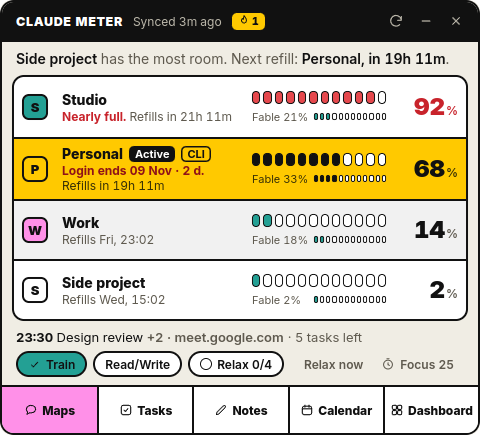
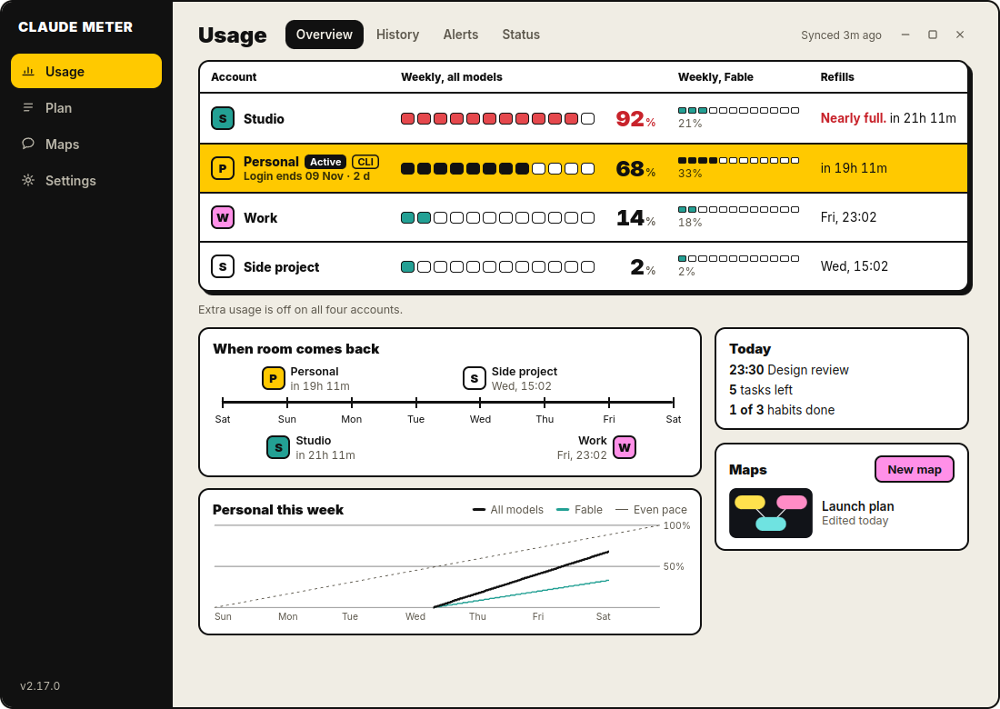
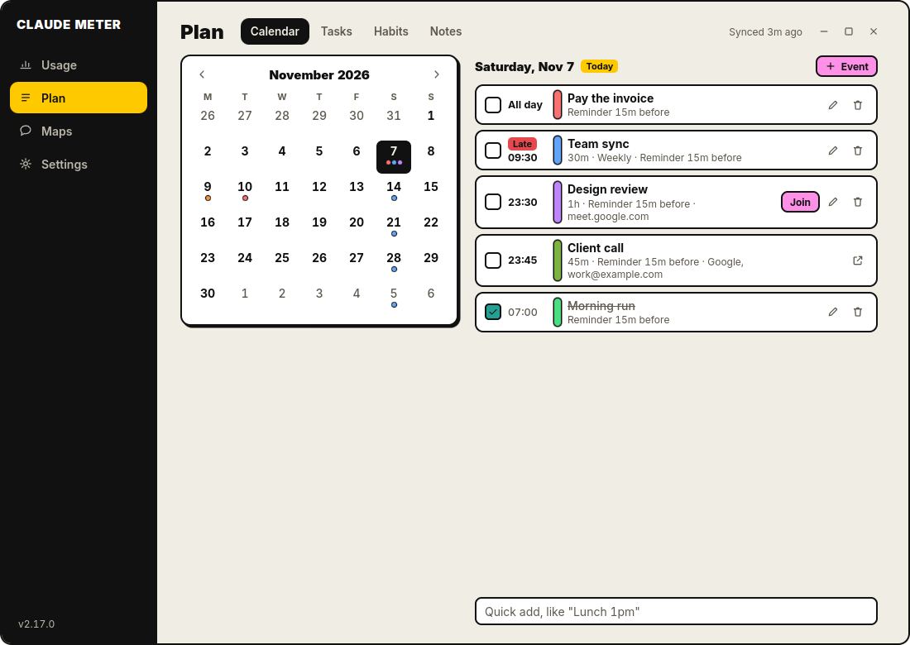
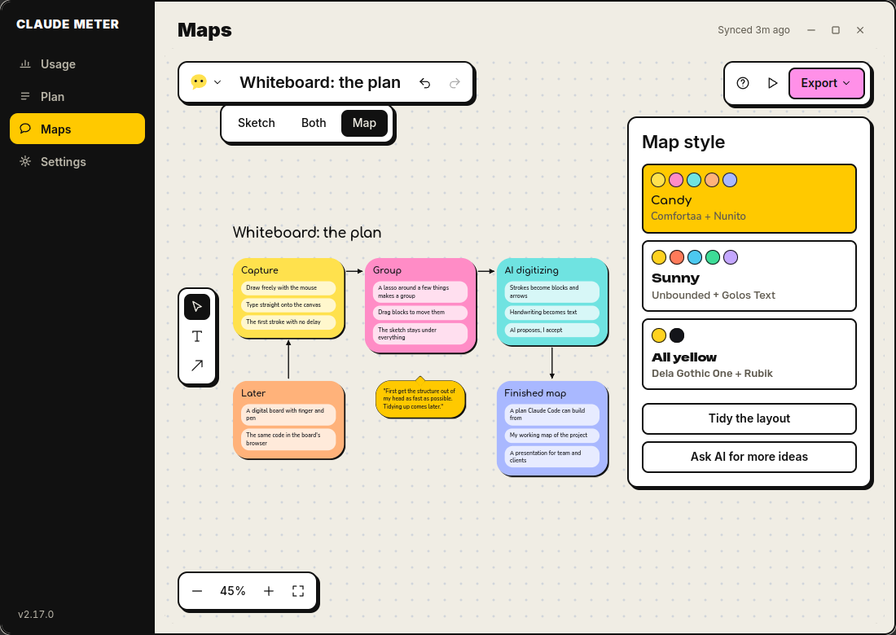
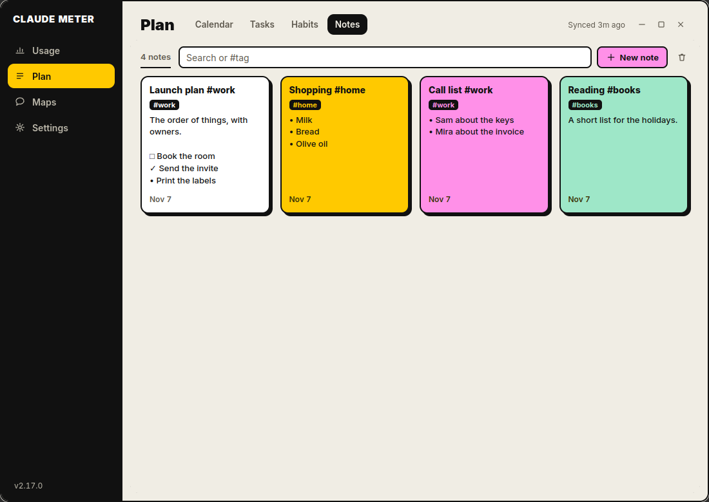

# Claude Meter

<p align="center">
  <a href="https://github.com/KrasimirKralev/claude-meter/stargazers"></a>
  <a href="https://github.com/KrasimirKralev/claude-meter/releases/latest"></a>
  <a href="https://github.com/KrasimirKralev/claude-meter/releases/latest"></a>
  
  <a href="LICENSE"></a>
</p>

A desktop widget that shows your **Claude usage** in real time, for every account at once: what's left this week, what refills next, and which account has the most room. Around it sits a small planner (calendar, tasks, habits, notes), short relax breaks, and **Maps**, which turns a sketch into a finished bubble map.

> **Unofficial; not affiliated with Anthropic.** Claude Meter is an independent open-source tool that reads the login
> [Claude Code](https://claude.com/claude-code) already keeps on your machine.

<p align="center">
  
</p>

## Screenshots

| Dashboard | Plan |
|:---:|:---:|
|  |  |
| Every account in one table, when room comes back, and this week against an even pace. | The calendar's month beside the day, with tasks, habits and notes one tab away. |

| Maps | Notes |
|:---:|:---:|
|  |  |
| Sketch freely, press Digitize, and get a finished map. | A board of notes with a Markdown editor. |

---

## Platforms

| Platform | Status |
|----------|--------|
| macOS (Apple Silicon and Intel) | Released: unsigned DMGs on the [Releases](../../releases/latest) page, built by CI. |
| Linux | Runs from source (see [Build from source](#build-from-source)). No packaged build yet. |
| Windows | Untested. The app has not been verified on Windows, and no installer is published. |

## Download (macOS)

Grab the latest build from the [**Releases**](../../releases/latest) page:

| File | For |
|------|-----|
| `Claude.Meter-<version>-arm64.dmg` | Apple Silicon (M1 / M2 / M3 / M4) |
| `Claude.Meter-<version>-x64.dmg` | Intel Macs |

> The build is **unsigned** (no paid Apple Developer certificate), so macOS Gatekeeper will warn on first launch. This is expected.

### First launch (one time)

1. Open the `.dmg` and drag **Claude Meter** into **Applications**.
2. In **Applications**, **right-click** the app → **Open** → **Open** in the dialog.

If macOS still refuses (*"app is damaged / can't be opened"*), open **Terminal** and run:

```bash
xattr -cr "/Applications/Claude Meter.app"
```

then open it normally. After the first open it launches like any other app.

---

## Requirements

Claude Meter reads your usage from the **Claude Code** credentials on your machine
(`~/.claude/.credentials.json`). So you need [Claude Code](https://claude.com/claude-code)
installed and logged in (`claude` on your PATH). The app has no API key of its own —
it reuses the OAuth token Claude Code already has. When that token is close to expiring,
the app refreshes it with Anthropic and writes the new token back to the same file.

If you're not logged into Claude Code, the usage bars will be empty.

---

## Features

- **Every account at once.** Log each Claude account into its own `CLAUDE_CONFIG_DIR` (`~/.claude-<name>`) and the widget lists them all, with one line saying who has the most room and what refills next.
- **Usage.** Session, weekly and per-model limits as the server reports them, with refill times, extra usage, history, and alerts at the levels you choose.
- **Maps.** A dotted canvas inside the dashboard. Draw with the mouse, a pen or touch, press **Digitize**, and AI proposes a finished bubble map that you accept piece by piece. Export a plan, Markdown, an image or a backup, or press F to present. It uses the account with the most room. See [`maps/`](maps/).
- **Calendar.** Local events, repeating ones, reminders you choose per event, and optional read-only Google Calendar sync (see below). Meetings with a Meet, Zoom or Teams link get a Join button.
- **Tasks.** Type "Call Sam tomorrow 3pm" and it becomes a task with a calendar event. Priorities, drag to reorder, a note per task, and a streak.
- **Notes.** A board of notes with a Markdown editor, tags, search, tables, and export to Markdown or PDF. It's a tab in the dashboard and also its own window.
- **Habits.** Training, reading and relax on one board, a month at a time, with streaks.
- **Relax breaks.** Short full-screen scenes with music, a few times a day, with a heads-up you can put off or skip.
- **Quick task.** `Ctrl+]` from anywhere opens a box that adds a task.
- **Themes.** Brutal, Karchx, Light, Dark, Nord and Dracula, across every window.

---

## Configuration

### Settings

Preferences (theme, hotkey, thresholds, window position) live in `~/.claude/usage-widget-settings.json`
and are written by the app, so edit them through the dashboard, not by hand. If a data file is ever damaged, the app
sets it aside as `<name>.bad-<time>` rather than overwriting it.

### Google Calendar setup (optional)

Calendar sync is **off by default** and needs **your own** Google OAuth client
(the app ships with none, so it's safe and fully yours). One-time setup:

1. Go to the [Google Cloud Console](https://console.cloud.google.com/) → create/select a project.
2. **APIs & Services → Enable APIs** → enable **Google Calendar API**.
3. **APIs & Services → Credentials → Create Credentials → OAuth client ID**.
   - Application type: **Desktop app**.
   - Copy the **Client ID** and **Client secret**.
4. Add yourself as a **Test user** under **OAuth consent screen** (keeps the app in "testing" — no verification needed for personal use).
5. Provide the credentials to Claude Meter one of two ways:

   **a) Config file** (recommended) — create `~/.claude/usage-widget-google.json`:
   ```json
   {
     "client_id": "YOUR_ID.apps.googleusercontent.com",
     "client_secret": "YOUR_SECRET"
   }
   ```
   (An example is in [`usage-widget-google.example.json`](usage-widget-google.example.json).)

   **b) Environment variables** — set `GCAL_CLIENT_ID` and `GCAL_CLIENT_SECRET` before launching.

6. Restart the app, open **Settings**, and click **Add a Google account**.

The OAuth redirect uses a temporary `http://127.0.0.1:48271/callback` loopback — nothing is sent anywhere except Google. Scope is **read-only** (`calendar.readonly`).

---

## Build from source

The app itself needs only Electron and Chart.js (no native modules). Maps is its own project in [`maps/`](maps/), with its own dependencies, and needs Node 24 to build. Without that step the app still runs, with no Maps section.

```bash
npm install
npm run bundle:maps    # builds maps/ once; the npm run build scripts do this themselves
npm start              # run from source (macOS, Linux)
npm test               # the app's tests
npm run test:maps:install && npm run test:maps   # Maps' tests
npm run build:mac      # macOS DMGs (must run on macOS)
```

`npm run build:linux` (AppImage) and `npm run build:win` (NSIS installer) are defined in `package.json`,
but neither runs in CI and no Linux or Windows package has been released.

### macOS builds via CI

macOS DMGs must be produced **on macOS**. This repo's GitHub Actions workflow
([`.github/workflows/build-mac.yml`](.github/workflows/build-mac.yml)) builds both
arm64 and x64 DMGs on every push to `main` (docs-only changes are skipped) and publishes them to a Release — no Mac
required to ship.

---

## Tech

Electron 33 · Chart.js · vanilla JS (no framework) for the app, and React with Vite for Maps. All rendering is safe-DOM (no `innerHTML`). Your Claude Code
token is only ever sent to Anthropic (the usage endpoint and its token refresh).

A sketch leaves your computer only when you press Digitize. Maps' server listens on 127.0.0.1 only and runs only while the dashboard has Maps open.

## Contributing

PRs welcome — bugfixes, new widgets, themes, extra integrations. Thanks to everyone who's chipped in:

- [@GeorgiK77](https://github.com/GeorgiK77) — quick-task global shortcut

If Claude Meter is useful to you, a star helps other people find it.

More from [@KrasimirKralev](https://github.com/KrasimirKralev): [Harvest Hollow](https://github.com/KrasimirKralev/harvest-hollow),
a cozy 3D farming game for two that runs in the browser.

## License

MIT — do whatever you like. Customize it, rebrand it, ship it.
