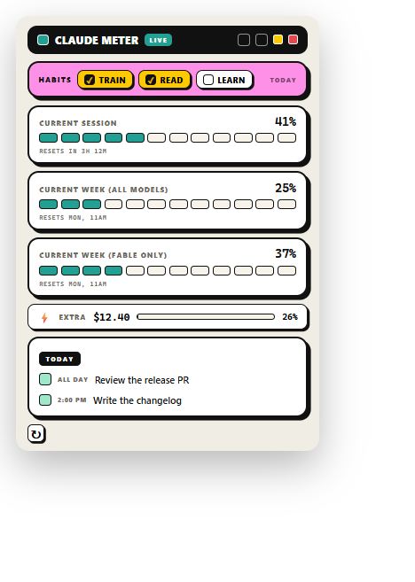
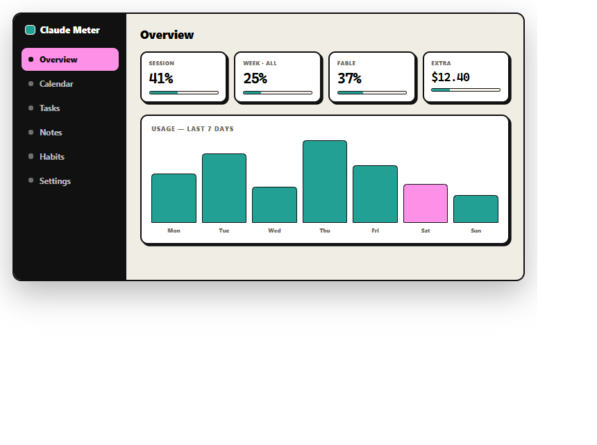
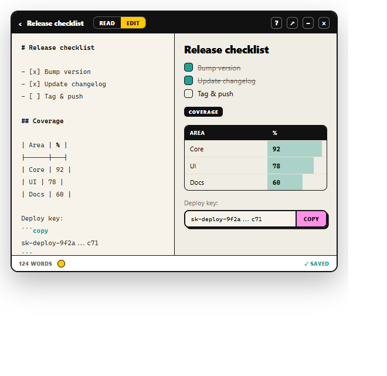

# Claude Meter

A desktop widget that tracks your **Claude usage** in real time — current session, weekly (all models), Fable-only, and pay-as-you-go **extra-usage spend** — with a built-in planner: **calendar** (with optional Google Calendar sync), **tasks**, **notes** (markdown editor), and **habit tracking**. Pop-brutalist UI, always-on-top, snap-to-edge.

<p align="center">
  
</p>

## Screenshots

| Dashboard | Notes editor |
|:---:|:---:|
|  |  |
| Usage overview, 7-day history, and the full planner. | Split markdown editor with live preview, tables → inline bars, and click-to-copy fields. |

---

## Download (macOS)

Grab the latest build from the [**Releases**](../../releases/latest) page:

| File | For |
|------|-----|
| `Claude.Meter-<version>-arm64.dmg` | Apple Silicon (M1 / M2 / M3 / M4) |
| `Claude.Meter-<version>-x64.dmg` | Intel Macs |

> The build is **unsigned** (no paid Apple Developer certificate), so macOS Gatekeeper will warn on first launch. This is expected.

### First launch (one time)

1. Open the `.dmg` and drag **Claude Meter** into **Applications**.
2. In **Applications**, **right-click** the app → **Open** → **Open** in the dialog.

If macOS still refuses (*"app is damaged / can't be opened"*), open **Terminal** and run:

```bash
xattr -cr "/Applications/Claude Meter.app"
```

then open it normally. After the first open it launches like any other app.

---

## Requirements

Claude Meter reads your usage from the **Claude Code** credentials on your machine
(`~/.claude/.credentials.json`). So you need [Claude Code](https://claude.com/claude-code)
installed and logged in (`claude` on your PATH). No API key is stored by this app —
it reuses the OAuth token Claude Code already has.

If you're not logged into Claude Code, the usage bars will be empty.

---

## Features

- **Usage meters** — current session, weekly (all models), Fable-only, each as a segmented bar with reset countdown.
- **Extra-usage strip** — how much pay-as-you-go credit you've spent this month vs your limit, color-coded (teal → yellow at 80% → red at 100%). Auto-hidden if you don't have extra usage enabled.
- **Calendar** — local events + optional read-only Google Calendar sync (see below).
- **Tasks** — quick to-dos with a completion-streak badge.
- **Notes** — sticky board + a markdown editor with live preview, tables, and click-to-copy fields for links/keys.
- **Habits** — Training / Reading / Learning day-trackers with monthly calendars, reflected on the widget.

---

## Configuration

### Settings

Preferences (theme, hotkey, thresholds, window position) live in `~/.claude/usage-widget-settings.json`
and are written by the app — edit through the dashboard, not by hand.

### Google Calendar setup (optional)

Calendar sync is **off by default** and needs **your own** Google OAuth client
(the app ships with none, so it's safe and fully yours). One-time setup:

1. Go to the [Google Cloud Console](https://console.cloud.google.com/) → create/select a project.
2. **APIs & Services → Enable APIs** → enable **Google Calendar API**.
3. **APIs & Services → Credentials → Create Credentials → OAuth client ID**.
   - Application type: **Desktop app**.
   - Copy the **Client ID** and **Client secret**.
4. Add yourself as a **Test user** under **OAuth consent screen** (keeps the app in "testing" — no verification needed for personal use).
5. Provide the credentials to Claude Meter one of two ways:

   **a) Config file** (recommended) — create `~/.claude/usage-widget-google.json`:
   ```json
   {
     "client_id": "YOUR_ID.apps.googleusercontent.com",
     "client_secret": "YOUR_SECRET"
   }
   ```
   (An example is in [`usage-widget-google.example.json`](usage-widget-google.example.json).)

   **b) Environment variables** — set `GCAL_CLIENT_ID` and `GCAL_CLIENT_SECRET` before launching.

6. Restart the app, open the **Calendar**, and click **Connect Google Calendar**.

The OAuth redirect uses a temporary `http://127.0.0.1:48271/callback` loopback — nothing is sent anywhere except Google. Scope is **read-only** (`calendar.readonly`).

---

## Build from source

Only dependency is Electron + Chart.js (no native modules).

```bash
npm install
npm start              # run in dev
npm run build:mac      # macOS DMG   (must run on macOS)
npm run build:win      # Windows installer
npm run build:linux    # Linux AppImage
```

### macOS builds via CI

macOS DMGs must be produced **on macOS**. This repo's GitHub Actions workflow
([`.github/workflows/build-mac.yml`](.github/workflows/build-mac.yml)) builds both
arm64 and x64 DMGs on every push to `main` and publishes them to a Release — no Mac required to ship.

---

## Tech

Electron 33 · Chart.js · vanilla JS (no framework). All rendering is safe-DOM (no `innerHTML`), credentials never leave your machine.

## License

MIT — do whatever you like. Customize it, rebrand it, ship it.
